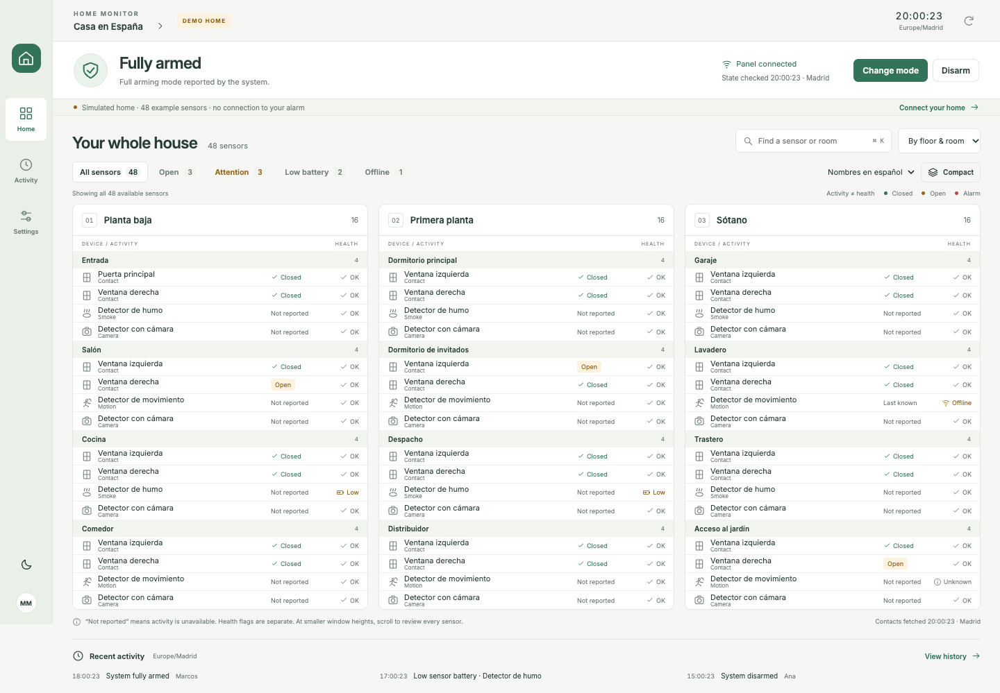

# Home Monitor

A macOS-first, unofficial Sector Alarm desktop application. The main view puts a compact, expanded whole-house sensor inventory ahead of activity and settings. It starts in an unmistakable **48-device demo**, never signs in automatically, and never sends a real command on startup.



## Run

Requirements: Node.js 22+ and npm; macOS is the tested desktop platform. The dependency lockfile is included.

```sh
npm ci
npm run dev                # Electron desktop, starts in demo
```

For a production build:

```sh
npm run build
npm start
npm run pack:mac           # dist/mac-arm64/Home Monitor.app on Apple Silicon
npm run dist:mac           # DMG + ZIP for the build machine architecture
```

The generated `.app` in this workspace is runnable locally. Distribution requires your own Apple Developer signing identity and notarization; this build is unsigned. Windows packaging is configured (`npm run dist:win`) but has not been exercised. Build Windows installers on Windows.

```sh
npm run dev:web            # http://127.0.0.1:5173, demo-only browser preview
```

## Use your alarm

At launch, the window centers on the display containing your pointer and fits its usable area, leaving a 16-pixel margin around the window and respecting the Dock/menu bar or taskbar. It grows up to 1800 × 1200 logical pixels on larger displays. You can still resize it manually; smaller screens keep all content accessible by scrolling.

1. Open **Connect your home** in the desktop application.
2. Sign in with your Sector Alarm account and select your property. Connecting performs reads only.
3. Optional **Remember securely** stores an encrypted credential blob protected by Electron's OS credential facility (macOS Keychain; Windows DPAPI). Tokens remain in the main process's memory. No password or panel code goes into local display settings.
4. The live connection starts **read-only**. To intentionally use alarm commands, enable live controls under Settings. Every command requires its explicit confirmation and panel code; codes are not persisted.
5. A command is only confirmed by a matching, connected system state. An unknown outcome locks further commands until **Reconcile state** reads the actual state. No security command is automatically retried.

Development tests use synthetic responses. A subsequent user-requested read-only check verified login, property selection, armed state, and 36 sensors across three floors on the connected account. No live alarm command has been sent. Login flows that require unsupported MFA are not bypassed: use the official app and report the unsupported flow.

## What is implemented

- An expanded floor/room inventory, optional device-type grouping, search, exception filters, explicit total/hidden counts, and a contextual sensor panel.
- 48 demo devices across three floors and 12 rooms. In compact mode all 48 sensor rows fit at 1440 × 900. Activity is below the inventory. Smaller windows, comfortable density, or an open detail panel require page scrolling; no rooms are silently collapsed or paginated.
- Independent activity and health indicators: an open contact is not an alarm or an unhealthy device. Unsupported motion/smoke activity, missing battery/connectivity values, and tamper data stay unknown.
- Light/dark/system appearance; compact/comfortable density; keyboard focus, native dialog focus trapping, Escape, and Cmd/Ctrl+K search.
- Spanish floor/room labels from documented translation keys, preserved custom names, persistent local Spanish device aliases, and original-name fallback. Edit a device's local alias and floor/room grouping in its side panel. All edits stay on this computer.
- All absolute timestamps are formatted in `Europe/Madrid`, 24-hour `YYYY-MM-DD · HH:mm:ss`, with automatic DST. Offsetless legacy event times remain explicitly labeled local wall times; their ambiguous absolute instants are never guessed.
- Latest 80 activity records, with local alarm/health filters and total record count. Unknown event types are preserved; actors are shown only if supplied.
- Demo scenarios for stale/offline connections, partial failures, expired authentication, sensor alarm, rejected commands, and unknown outcomes.

## Live API scope and limits

See [capability assessment](docs/API-ASSESSMENT.md) and the pinned [reference documentation](docs/API-REFERENCE.md).

| Capability                                                                 | Implementation                                                                               |
| -------------------------------------------------------------------------- | -------------------------------------------------------------------------------------------- |
| Legacy verified login, property list and panel metadata                    | Live HTTP adapter                                                                            |
| SAS v3 area state, partial-arm capability, panel connectivity              | Live HTTP adapter                                                                            |
| SAS contact + temperature property plans                                   | Live HTTP adapter with endpoint-specific legacy fallbacks; merges physical sensors by serial |
| Legacy TC state and sensor inventory                                       | Documented legacy sensor reads supported; legacy alarm commands remain unavailable           |
| Full arm, partial arm, disarm for SAS                                      | Explicitly enabled, code-confirmed commands; returned-state confirmation                     |
| Remote rename, siren, lock, automation changes             | Not exposed                                                                                  |
| Native push, desktop notifications                                         | Not implemented; no real-time monitoring claim                                               |
| Tamper, general live motion/smoke state, individual last-report timestamps | Not supplied by the selected documented reads; shown as unavailable                          |

Alarm state polls every 3 minutes, sensor plans every 15, history every 10. A normal steady modern-API session uses about 36 requests/hour, plus connection/manual actions. This app conservatively caps itself at 44 requests per clock hour, preserves the meter across restarts, and stops on 429 until the next hour. The community-observed service limit is about 60/hour **shared with the phone app**; the app cannot know requests made elsewhere. Manual refresh is coalesced and throttled to at least 15 seconds per block. Inventory metadata is fetched when selecting a property; reconnect/reselect after changing panel capabilities.

Successful HTTP fetch time is not a sensor report time. The interface keeps old values with warnings after partial failures, tracks per-source refreshes, marks sensor data stale after 20 minutes or a failed source, and disables controls when state is stale/offline. Computer resume triggers a budgeted refresh. This is a polling companion, not a replacement for the monitoring service or official emergency alerts.

## Validation

```sh
npm test                   # domain + HTTP/session/command tests
npm run typecheck
npm run test:e2e            # Chrome installed; local demo browser tests
npm run test:desktop        # builds and opens Electron with temporary isolated data
```

The desktop smoke test uses a disposable profile, verifies the sandboxed preload bridge and absence of renderer Node access, and sends **demo-only** commands. It makes zero live API requests. See [validation report](docs/VALIDATION.md).

## Architecture

- `src/main/api.ts`: fixed-host HTTP, in-memory authentication, retry policy, persistent request budget.
- `src/main/service.ts`: refresh scheduling, independent source snapshots, command gate, demo scenarios.
- `src/main/index.ts`: Electron lifecycle, OS-protected credential persistence, narrow validated IPC.
- `src/preload`: sandbox-compatible CommonJS context bridge; no generic IPC/network interface exposed.
- `src/shared`: normalized types, response normalization, documented place dictionary, Madrid time formatting, synthetic demo data.
- `src/renderer`: presentation and local display preferences. Browser preview uses an injected transport that rejects every network call.

The renderer is sandboxed with context isolation, Node disabled, a restrictive CSP, denied permissions, and blocked external navigation/new windows. IPC accepts only the application's main frame. Preferences contain display choices and aliases, not secrets. Settings and encrypted credentials are written with owner-only permissions in the OS application data directory. Disconnect & forget deletes saved credentials and clears the in-memory token/password.

## Reference provenance

Inspected the initially empty target repository and the technical API documentation/client of [sector-alarm-dashboard](https://github.com/marcosmro/sector-alarm-dashboard) at commit `666d8417661657761bf39926d960d8b94632283d`. That repository was treated read-only. The documented location dictionary and API reference are reused with attribution; the application and UI are new. The reference's metadata declares MIT licensing. Its API documentation is unofficial, based on app analysis and reported Spanish-account observations—not an official Sector Alarm public API contract.

### Inventory compatibility correction

Panel `Vendor` is informational, not an inventory gate. As in the working reference client, the app tries modern state/contact/temperature/camera endpoints and falls back independently on actual HTTP 404 responses. Legacy contact, temperature (including flat fallback), camera, smoke, and flood reads are supported. State fallback never disables modern sensors. Missing data remains unknown; malformed responses, authentication failures, and rate limits do not masquerade as unsupported capabilities. Camera inventory and legacy smoke/flood reads run every 30 minutes. Legacy sessions can use about 40 requests/hour plus startup/manual actions, within the same enforced 44-request cap.

### Read-only diagnostic

`node scripts/check-connection.mjs --keep-open` launches the packaged app and uses its saved-account bridge. It only selects automatically when exactly one property is available, never enables alarm controls, and prints non-identifying status/count summaries. It uses the real saved account and consumes the normal request budget, so it is a manual diagnostic, not a test-suite command. A live screenshot is saved only to `/tmp/home-monitor-live-check.png`, not to the repository.

### Temperature overview

The overview shows Celsius readings per sensor, room averages in room headers, and a house average beside the title. Reported averages are retained from the existing temperature response; when unavailable, the app calculates an equal-weight mean of usable sensor readings. Stale, offline and inactive readings are excluded from calculated averages. Missing readings show a dash. Search and filters never change the averaging scope. Hover a temperature or open sensor details to inspect freshness and source information.

### Cameras and local photo history

Open **Cameras** to take a photo from one camera or use **Capture all**. Captures run sequentially, typically taking 20–30 seconds per camera, with a 120-second timeout. The system must be online and fully armed; the app never arms it automatically. Captures work independently of the alarm-controls read-only setting.

The queue checks the shared 44-request/hour app budget and requires headroom for status/authentication. Each photo uses one request; state checks and authentication also count. Background polling pauses during the queue. Status is checked at the start and refreshed between cameras when necessary. Stop after the current photo cancels pending work; a failed capture stops the batch, except for a definitive per-camera HTTP 405 rejection, which is recorded while the remaining cameras continue. Capture GET requests are never automatically retried after a 401 or timeout, because they trigger a physical action. Legacy capture uses the camera inventory's explicit device ID; unknown IDs are not guessed. No capture-endpoint fallback is attempted automatically.

Photos are kept under the application's user-data `photos` folder (macOS: `~/Library/Application Support/Home Monitor/photos`). Libraries are separated by property, with demo images separate from live images. Files use owner-only permissions and are not separately encrypted by the app. They remain until deleted. The gallery loads 48 at a time, offers older pages and camera filtering, and labels the local receipt time in Europe/Madrid; this is not a verified camera exposure timestamp. Open a photo to export its original JPEG/PNG through a native save dialog or permanently delete it with confirmation. Exported copies are independent of the gallery. Browser demo images last only for that page session.

Run `node scripts/camera-smoke.mjs` after `npm run pack:mac` for an isolated, zero-network desktop check of capture, restart persistence, image decoding, export and deletion.

### Temporary request-cap override

The app defaults to 44 requests per clock hour. Use **Override cap for this hour** in the paused banner, connection dialog, Settings, or the camera batch budget notice to temporarily remove that local cap. Usage continues to be counted and displayed. **Restore request cap** turns it off immediately. It also expires at the next hour, on restart, or when the session is cleared. It is never saved as a preference. Camera batch admission respects this setting, but captures remain sequential and failed captures are not retried. A provider HTTP 429 still blocks requests; this option cannot bypass Sector Alarm's server limit. Enabling the override does not itself send a request or retry a capture, though normal scheduled polling can resume.

Capture progress includes a time estimate starting at 25 seconds per camera and adapting to successful captures in the current batch. The estimate is not byte-level upload progress; slow captures show elapsed time, and an unfinished camera never appears complete. The active camera has an animated indicator (respecting reduced-motion settings). Compact thumbnails open a modal with 100–400% relative-to-fit zoom, Fit reset, double-click zoom and drag-to-pan.

Camera HTTP 405 responses now retain a bounded server explanation and the `Allow` header in the on-screen error. These diagnostics are not written into photo files or logs. A 405 is not automatically retried with another HTTP method. Two successful cameras followed by a 405 on another camera do not establish a global method mismatch; the specific response is needed to diagnose the rejected camera.

### Desktop launcher for the latest local code

Run `npm run install:launcher` once on this Mac. It installs **Home Monitor Latest.app** in `~/Applications` and links it on the Desktop, using the Home Monitor icon. Drag that launcher into the Dock if desired. Every launch runs `npm run pack:mac` in this checkout, then quits the older Home Monitor instance and opens the newly built bundle. Local uncommitted edits are included; no Git pull or automatic dependency install is performed. Finish camera captures before restarting. Saved credentials, preferences and local photos stay in the application-data folder.

A failed build displays an error and does not launch an older bundle. Build output is saved to `~/Library/Logs/Home Monitor/latest-build.log`; startup and handoff output is saved to `latest-launch.log` in the same folder. The launcher closes the previous Home Monitor process without Apple Events, avoiding a separate macOS Automation permission requirement. This launcher requires the checkout and installed dependencies to remain available; reinstall the launcher after moving the project. It currently targets this Apple Silicon Mac.

Live batches now pause 10 seconds between cameras to reduce consecutive panel requests. This is a conservative client choice, not a documented Sector Alarm limit or a confirmed solution for intermittent 405 responses. Canceling during the pause prevents the next request. A missing complete response is shown as an unknown outcome and stops the batch; the summary distinguishes failures, unknown outcomes and skipped cameras. Existing thumbnails are labeled with their saved date.

### House map

**House map** is a separate view using the current sensor snapshot, with no additional API calls. Room/floor metadata matches sensors to local room guides; window and door metadata chooses tentative opening positions. Dashed markers are **Suggested**, not verified physical locations. Ambiguous matches remain **Unplaced**. Status colors distinguish alarm, attention, closed/healthy, and unavailable or stale readings.

Select **Edit locations**, select a sensor, then drag its marker or click a position on the plan. To move it between plans, keep it selected, choose another plan and click the new position. The room selector places it at a room's center for further adjustment. **Confirm this location** accepts a suggestion; **Remove from map** returns it to Unplaced. Edits save automatically and persist across restarts. Zoom/Fit and drag-to-pan support inspecting individual openings; arrow keys move focused markers in edit mode (Shift for larger steps).

Private plans and placement guides are imported with `node scripts/import-house-map.mjs path/to/map-project.json`, with JPEGs alongside the catalog under `plans/<plan-id>.jpg`. Prepared assets in `private-house/` are Git-ignored and excluded from app packaging. Imported files live in `~/Library/Application Support/Home Monitor/house-map`; placement files are separated by property and demo mode. Back up that folder to preserve plans and corrections. The browser demo uses fictional plans only. The 2D editor is also the source for the estimated 3D view below.

After building, `node scripts/map-smoke.mjs path/to/map-project.json` verifies private image decoding and location persistence in a disposable desktop demo profile, without live requests or retained screenshots.

The map supports locally traced vector geometry with room fills, stairs, glazed openings, door swings and opening labels. **Original plan** switches back to the imported scan for comparison. Labels such as V01/P01 identify drawing openings, not API sensor numbers. In editing mode, **Place at identified opening** moves a selected sensor to that opening.

Private camera hints can attach a position, direction, confidence and explanation to a specific camera ID using an existing archived photo. Selecting the camera shows that reference photo (click to enlarge); **Camera direction** rotates the marker's direction indicator and persists the edit. The direction fan is illustrative, not calibrated field of view, range, visibility or coverage. **Use photo-based position** restores the suggested position/direction; previously saved local corrections otherwise take precedence. No fresh capture or additional API request is involved. Geometry, evidence and camera identifiers stay in the private catalog, outside the package and Git.

### Estimated 3D view

In **House map**, choose **3D model** to orbit a model of the selected plan. Cutaway/full-wall modes, room labels and an assumed ceiling-height control aid review. **Export 3D model** downloads a Wavefront OBJ mesh in metres with Y up. **Edit locations** returns to the 2D editor; existing sensor placements are projected onto the 3D floor and retain their uncertainty.

Local model guides can specify provisional split levels, double-height spaces, stairs and simple furnishings. A timestamped **Video / plan cross-check** distinguishes supported observations, discrepancies and unknowns. The model is an architectural reconstruction from drawings and visual observations, not photogrammetry or a measured survey. Plans remain separate because cross-plan registration is not established. Wall/opening heights, wall thickness and floor offsets are assumptions. Photo-informed guides can add sloping ceilings, optional roof surfaces, rails, supports, window frames and multiple glazing bands. The roof/ceiling toggle shows the provisional envelope, and exports include it. The Photo / structure cross-check records supporting filenames and unresolved matches. Explicit ceiling profiles retain their own estimates when the default height changes. Hidden construction is omitted. No model processing, orbiting or exports call the alarm API or upload private source media.

Local guides may also provide a separate **Exterior** scene: driveway, garden, terrain and an estimated building envelope. Exterior scenes open with the roof visible; the site sketch is an original schematic. Boundary and elevation uncertainty is recorded in the scene notes. They do not imply registration of the separate interior plans or relocate existing sensors.
